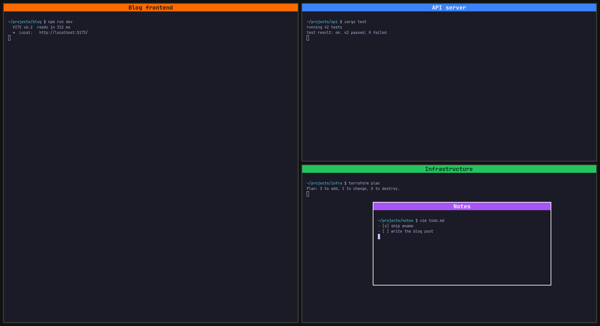

# wname

[](https://github.com/pahlisch/wname/actions/workflows/ci.yml)
[](LICENSE)

Put a large, colored name band on a Hyprland window, so you can tell your
five terminals apart at a glance.



```sh
wname -n "Blog project"          # name the window this runs in
wname -n "Blog project" -c red   # …in red
wname --clear                    # remove it
```

The band sits along the top edge of the window. It follows the window when
it moves, resizes or retiles. It hides whenever the window is out of view:
another workspace, a special workspace on top, fullscreen, a background tab
in a group, or another window stacked over it. Clicks go straight through
it to the window underneath.

## Install

You need Hyprland, GTK 4.12 or later, and
[gtk4-layer-shell](https://github.com/wmww/gtk4-layer-shell) 1.0 or later.

```sh
# Arch
sudo pacman -S gtk4 gtk4-layer-shell rust

cargo install --git https://github.com/pahlisch/wname   # installs to ~/.cargo/bin/wname
```

Or from a clone: `cargo install --path .`

## Usage

```
wname -n TEXT [-c COLOR] [-w ADDRESS]   name a window (see "Which window" below)
wname --clear [-w ADDRESS]              remove a window's band
wname --clear-all                       remove every band
wname --list                            show every band, and why any is hidden
wname --colors                          show the palette
wname --quit                            stop the daemon
```

**Colors:** `orange`, `amber`, `blue`, `green`, `red`, `purple`, `yellow`,
`pink`, `teal`, `random`, or any `#rgb` / `#rrggbb`. For custom colors the
text is black or white, whichever reads better. With no `-c`, renaming a band
keeps its color, and a new band gets a palette color that no other band is
using.

**Renaming:** run `wname -n` again on the same window.

### Which window

`wname` names the window it runs in: the terminal whose process started it,
found by walking up the parent processes. That holds even when another window
has focus. So an agent or script that runs `wname` in its own terminal names
that terminal, even while you are typing somewhere else.

When no window started it, as with a keybinding or a detached tmux server,
it names the focused window and says so. `--focused` always uses the focused
window, and `-w ADDRESS` names a specific window (addresses are in
`hyprctl clients`).

If one process owns several windows, as with `foot --server` or a browser,
`wname` cannot tell them apart. It then uses whichever of them has focus. If
none of them has focus, it lists them and asks for `-w`.

### Keybindings

Hyprland with a Lua config:

```lua
hl.bind("SUPER + ALT + BACKSPACE", hl.dsp.exec_cmd("wname --clear"))
-- Prompt for a name with any dmenu-style launcher:
hl.bind("SUPER + ALT + N", hl.dsp.exec_cmd([[sh -c 'n=$(printf "" | fuzzel --dmenu -p "Name: ") && wname -n "$n"']]))
```

With `hyprland.conf`:

```ini
bind = SUPER ALT, BACKSPACE, exec, wname --clear
bind = SUPER ALT, N, exec, sh -c 'n=$(printf "" | fuzzel --dmenu -p "Name: ") && wname -n "$n"'
```

The band is a layer surface with the namespace `wname`. To stop Hyprland
fading it in and out:

```lua
hl.layer_rule({ match = { namespace = "wname" }, no_anim = true })
```

```ini
layerrule = no_anim on, match:namespace wname
```

## How it works

`wname` is a small command that talks to a background daemon over a Unix
socket. The first `wname -n` starts the daemon. The daemon exits on its own
a few seconds after the last band is gone.

The daemon draws every band from a single GTK process, one wlr-layer-shell
surface per band on the `top` layer: above every window, below menus and
notifications. It learns about workspace switches, moves, closes and
fullscreen changes from Hyprland's event socket. Hyprland sends no event
while a window is being dragged or resized, so the daemon also samples
window positions: every 16 ms while something is moving and every 100 ms
otherwise. It reads Hyprland's IPC socket directly for this rather than
running `hyprctl`. With four bands, the release build uses about 42 MB of
memory and about 0.3% of one CPU core at idle.

Hyprland reports where a window is *going*, not where it is drawn during an
animation. So when a window slides to a new place, or a workspace slides in,
the band steps aside for the length of that animation. It then reappears in
place, rather than racing ahead of the window. Hyprland's own animation
settings decide how long that is. If the pointer moves along with the
window, the move is a drag and the band follows at once.

Hyprland does not report window stacking order, so `wname` approximates it
to decide when a band is covered. From top to bottom: special workspace,
fullscreen, pinned, floating, tiled. Within each level, the most recently
focused window is on top. When another window covers part of a band, the
band shrinks to the widest uncovered stretch. When too little is left, it
hides.

Bands survive a daemon restart. State lives in
`$XDG_RUNTIME_DIR/wname/<instance>/`, one directory per Hyprland instance.

## Limitations

* The band covers the top 24 px of the window's content, usually a
  terminal's first line. It is drawn over the window, not added to it.
* The font (JetBrains Mono Nerd Font, falling back to monospace) and size
  are fixed in the source.
* It works with Hyprland only. It relies on Hyprland's IPC for window
  positions and workspaces.
* Stacking order is an approximation (see above). A floating window that
  focus has not raised may be treated as covered or uncovered wrongly.

## Troubleshooting

* `wname --list` shows every band, and for a hidden one, why it is hidden.
* `WNAME_DEBUG=1 wname -n test` starts the daemon with debug logging to
  `$XDG_RUNTIME_DIR/wname/<instance>/daemon.log`. Run `wname --quit` first if
  a daemon is already running.
* If the band does not show at all, check that your compositor supports
  wlr-layer-shell (Hyprland does) and that `gtk4-layer-shell` is installed.

## Development

```sh
cargo test                       # unit tests: colors, placement, IPC parsing, protocol
scripts/test-nested.sh           # end-to-end tests in a throwaway nested Hyprland
```

The end-to-end tests start a nested Hyprland as a window in your current
session. They drive it with `hyprctl` and a virtual pointer, and check where
the compositor really put each band. They open and close `foot` windows and
change workspaces and monitors, but only inside that nested instance. They
refuse to run against any instance not started from
`tests/hyprland-test.conf`. You need `Hyprland`, `hyprctl`, `jq` and `foot`.

Covered scenarios: workspace switches (including how fast), moving windows
between workspaces and monitors, moving a whole workspace to another monitor,
special workspaces on the same and other monitors, floating windows covering
all or part of a band, retiling, floating move and resize, fullscreen and
maximize, pinned windows, groups, a second monitor coming and going, scaled
and rotated monitors, clicks passing through, animated retiling, daemon
restart, concurrent first calls, and user errors.

## License

MIT
